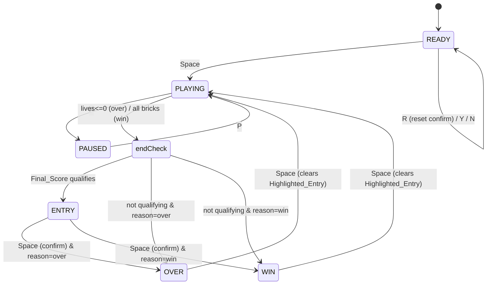

# Design Document

## Overview

This feature adds a persistent top-10 high-score leaderboard to Brick Buster. When a round ends in the OVER or WIN state with a qualifying score, the player is invited to enter three-letter initials arcade-style directly on the canvas, after which the score is saved to the browser's `localStorage` and the leaderboard is shown with the fresh entry highlighted. The leaderboard also appears on the start (READY) screen, where a confirmation-gated reset control lets the player wipe all scores.

The design extends the existing single-file IIFE architecture without introducing build tooling, frameworks, or modules. It reuses the established rendering helpers (`glowText`, `drawCenterText`, `THEME`), slots cleanly into the finite state machine, and threads initials-entry handling through the single `keydown` listener already in place.

### Design goals and constraints

- **No new runtime dependencies.** Everything stays inside the one `<script>` IIFE, in vanilla JS, consistent with the current file (Introduction, Requirements doc).
- **Pure logic separated from side effects.** Leaderboard operations (insert/order/trim, qualification, serialize/deserialize) are written as pure functions over plain data so they are deterministic and testable (supports Requirements 1, 2, 3, 6; enables the Correctness Properties below).
- **Graceful persistence.** All `localStorage` access is wrapped so a missing, corrupt, or inaccessible store never breaks gameplay (Req 1.3, 1.5, 1.6, 7.5).
- **State machine integrity.** The new `ENTRY` state suspends gameplay exactly like `PAUSED` does, and the existing OVER/WIN transitions are intercepted so qualification is evaluated before an end screen is shown (Req 3, 4).

### Research notes

The design relies only on platform behavior already present in the codebase, so no external libraries were researched. Two platform facts shaped the persistence design:

- **`localStorage` can throw, not just return `null`.** Reads/writes throw (e.g. `SecurityError`) when the store is disabled (private-mode policies, blocked third-party storage) and writes throw `QuotaExceededError` when full. The MDN Web Storage documentation describes `getItem` returning `null` for a missing key and access throwing when storage is unavailable ([MDN: Window.localStorage](https://developer.mozilla.org/en-US/docs/Web/API/Window/localStorage), [MDN: Using the Web Storage API](https://developer.mozilla.org/en-US/docs/Web/API/Web_Storage_API/Using_the_Web_Storage_API)). This is why both load and save are wrapped in `try/catch` and the missing-key (`null`) case is treated the same as "empty leaderboard" (Req 1.2, 1.3, 1.6). *Content was rephrased for compliance with licensing restrictions.*
- **`KeyboardEvent.key` already distinguishes the keys we need.** The existing handler uses `e.key`/`e.code`. Arrow keys surface as `"ArrowUp"`/`"ArrowDown"`/`"ArrowLeft"`/`"ArrowRight"` and letter keys as single characters, so initials entry needs no new input plumbing ([MDN: KeyboardEvent.key values](https://developer.mozilla.org/en-US/docs/Web/API/KeyboardEvent/key/Key_Values)). *Content was rephrased for compliance with licensing restrictions.*

## Architecture

### State machine extension

The current machine is `STATE = { READY, PLAYING, PAUSED, OVER, WIN }`. We add one state:

```js
const STATE = {
  READY: "ready",
  PLAYING: "playing",
  PAUSED: "paused",
  ENTRY: "entry",   // NEW: arcade initials entry for a qualifying score
  OVER: "over",
  WIN: "win"
};
```

`ENTRY` behaves like `PAUSED` with respect to the simulation: `update()` already early-returns unless `state === STATE.PLAYING`, so gameplay (ball, paddle, brick collisions) is automatically suspended in `ENTRY` with no extra guards (Req 4.5). Particle updates are likewise skipped because `loop()` only calls `updateParticles()` while `PLAYING`.



### Intercepting the end-of-round transition

The existing code sets `state = STATE.OVER` / `state = STATE.WIN` inline inside `update()` at two points: when `lives <= 0` and when `destroyed >= totalBricks`. Rather than scatter qualification logic across those sites, we funnel both through a single helper, `endRound(reason)`, where `reason` is `"over"` or `"win"`:

```js
function endRound(reason) {
  endingReason = reason;              // preserved so we can restore OVER vs WIN later
  if (reason === "over") sfxGameOver();
  else sfxWin();
  if (qualifies(leaderboard, score)) {
    beginEntry();                     // -> STATE.ENTRY
  } else {
    state = (reason === "over") ? STATE.OVER : STATE.WIN;  // Req 3.7, 4.6
  }
}
```

The two `update()` sites change from directly assigning `state` + playing a sound to simply calling `endRound("over")` / `endRound("win")`. The sound effects move into `endRound` so they play on exactly one path regardless of whether entry is shown (preserving current audio behavior). `endingReason` is a module-level variable that records why the round ended so that, after initials are submitted from `ENTRY`, the game restores the correct terminal state (Req 6.6).

### Module organization within the IIFE

New code is grouped into cohesive blocks inside the existing IIFE:

1. **Leaderboard pure logic** — plain functions over arrays/objects: `isValidRecord`, `clampAndInsert`/`addRecord`, `qualifies`, `serializeLeaderboard`, `deserializeLeaderboard`. No DOM, no `localStorage`, no canvas. These are the property-tested core.
2. **Persistence module** — `loadLeaderboard()` and `saveLeaderboard(board)`, the only functions that touch `localStorage`; both wrap the pure serialize/deserialize functions in `try/catch`.
3. **Entry controller** — `beginEntry()`, `handleEntryKey(e)`, and the `entry` state object; mutates entry state and, on confirm, calls into the pure logic + persistence.
4. **Reset controller** — `resetPending` flag plus `handleReadyKey(e)` branch for `R`/`Y`/`N`.
5. **Rendering** — `drawLeaderboard(...)` plus additions to the READY/OVER/WIN branches of `render()` and a new `ENTRY` branch.

This keeps the side-effecting edges (persistence, canvas, input) thin and pushes decisions into pure functions, which is what makes the Correctness Properties testable (see Testing Strategy).

## Components and Interfaces

### Pure leaderboard logic

```js
// A Score_Record is a plain object: { initials: "AAA", score: 12345 }
const MAX_RECORDS = 10;
const MAX_SCORE = 999999999;

// Req 1.8, 2.5, 2.6: structural + range validation. Returns boolean.
function isValidRecord(rec) {
  return rec
    && typeof rec.initials === "string"
    && /^[A-Z]{3}$/.test(rec.initials)
    && Number.isInteger(rec.score)
    && rec.score >= 0
    && rec.score <= MAX_SCORE;
}

// Req 2.1-2.4, 1.7, 6.2: insert, stable-sort descending by score, trim to 10.
// Returns a NEW array; does not mutate `board`. Returns `board` unchanged
// (copy) if `rec` is invalid (Req 1.8, 2.6 — rejection handled by caller's
// indication; this function is the "leave unchanged" guarantee).
function addRecord(board, rec) {
  if (!isValidRecord(rec)) return board.slice();
  const next = board.slice();
  // Find first existing record with a strictly smaller score; insert before it.
  // Scanning front-to-back and inserting before the first smaller score keeps
  // equal scores in insertion order (earlier-added ranks higher) -> Req 2.4.
  let i = 0;
  while (i < next.length && next[i].score >= rec.score) i++;
  next.splice(i, 0, rec);
  return next.slice(0, MAX_RECORDS); // Req 2.1, 2.3, 1.7
}

// Req 3.3-3.5: qualification.
function qualifies(board, finalScore) {
  if (!Number.isInteger(finalScore) || finalScore <= 0) return false; // Req 3.5
  if (board.length < MAX_RECORDS) return true;                        // Req 3.3
  return finalScore > board[board.length - 1].score;                 // Req 3.4
}
```

Notes:
- `addRecord` is **non-mutating** (returns a new array). The caller replaces the module-level `leaderboard` reference. This makes insert operations trivially property-testable without shared-state surprises.
- Equal-score tiebreak (Req 2.4) is a direct consequence of inserting *before the first strictly-smaller* score: an existing equal-scored record has `score >= rec.score`, so the scan steps past it and the new record lands after it.
- Validity rejection (Req 1.8, 2.6) is split: `addRecord` guarantees "leave unchanged," while the user-visible indication is raised by the entry/confirm caller when `isValidRecord` returns false.

### Serialization

```js
// Req 1.4, 6.4: produce the single stored string.
function serializeLeaderboard(board) {
  return JSON.stringify(board);
}

// Req 1.3: parse + validate. Returns a sanitized array of valid records
// (ordered/trimmed), or [] if the input is not a valid leaderboard.
function deserializeLeaderboard(text) {
  let parsed;
  try { parsed = JSON.parse(text); } catch (_) { return []; }
  if (!Array.isArray(parsed)) return [];
  // Keep only structurally valid records, then re-order/trim defensively so a
  // hand-edited or partially-corrupt store can't produce an out-of-order board.
  const clean = parsed.filter(isValidRecord);
  let board = [];
  for (const rec of clean) board = addRecord(board, rec);
  return board;
}
```

Re-building the board through `addRecord` means `deserializeLeaderboard` always returns a correctly ordered, length-≤10 board even if the stored JSON was tampered with — the ordering invariant is enforced on load, not just on insert.

### Persistence module (the only `localStorage` touchpoints)

```js
const STORE_KEY = "brickBuster.leaderboard.v1"; // single named key (Req 1.4, 6.4, 9.7)

// Req 1.1, 1.2, 1.3, 1.6, 7.5
function loadLeaderboard() {
  try {
    const raw = localStorage.getItem(STORE_KEY); // null if missing -> Req 1.2
    if (raw == null) return { board: [], ok: true };
    return { board: deserializeLeaderboard(raw), ok: true }; // Req 1.3 handled inside
  } catch (_) {
    // Store inaccessible (disabled/blocked). Req 1.6, 7.5.
    return { board: [], ok: false };
  }
}

// Req 1.4, 1.5, 6.4, 6.5, 9.7, 9.8. Returns true on success, false on failure.
function saveLeaderboard(board) {
  try {
    localStorage.setItem(STORE_KEY, serializeLeaderboard(board));
    return true;
  } catch (_) {
    return false; // quota/inaccessible -> caller shows indication, keeps memory
  }
}
```

`loadLeaderboard` returns `{ board, ok }`. `ok === false` means the store was inaccessible; callers can distinguish "legitimately empty" from "couldn't read" if ever needed, though both render the no-high-scores message (Req 7.2, 7.5). The in-memory `leaderboard` is always set to `board` regardless, so gameplay continues (Req 1.6).

### Entry controller

Module-level entry state:

```js
const LETTERS = "ABCDEFGHIJKLMNOPQRSTUVWXYZ";
let entry = { chars: ["A", "A", "A"], cursor: 0 }; // Initials + Initial_Cursor
let endingReason = null;        // "over" | "win" — why the round ended (Req 6.6)
let highlightedEntry = null;    // the Highlighted_Entry record reference (Req 6.3, 8.4, 8.5)
let statusMessage = null;       // transient user-visible indication (Req 1.5, 1.8, 6.5)

function beginEntry() {
  entry.chars = ["A", "A", "A"]; // Req 4.4
  entry.cursor = 0;              // Req 4.4
  state = STATE.ENTRY;           // Req 4.1
}
```

Key handling for `ENTRY` (dispatched from the main `keydown` handler):

```js
function handleEntryKey(e) {
  const k = e.key;
  if (k === "ArrowUp") {                 // Req 5.1 — next letter, wrap Z->A, cursor fixed
    e.preventDefault();
    entry.chars[entry.cursor] = cycleLetter(entry.chars[entry.cursor], +1);
  } else if (k === "ArrowDown") {        // Req 5.2 — prev letter, wrap A->Z, cursor fixed
    e.preventDefault();
    entry.chars[entry.cursor] = cycleLetter(entry.chars[entry.cursor], -1);
  } else if (k === "ArrowRight") {       // Req 5.3 / 5.4 — move right, no-op at index 2
    e.preventDefault();
    if (entry.cursor < 2) entry.cursor++;
  } else if (k === "ArrowLeft") {        // Req 5.5 / 5.6 — move left, no-op at index 0
    e.preventDefault();
    if (entry.cursor > 0) entry.cursor--;
  } else if (/^[a-zA-Z]$/.test(k)) {     // Req 5.7 / 5.8 — set letter + advance (sticky at 2)
    e.preventDefault();
    entry.chars[entry.cursor] = k.toUpperCase();
    if (entry.cursor < 2) entry.cursor++;
  } else if (e.code === "Space" || k === " ") { // Req 6.1 — confirm
    e.preventDefault();
    confirmEntry();
  }
  // Any other key: leave state unchanged (Req 5.9) — no branch taken.
}

function cycleLetter(ch, dir) { // dir = +1 or -1, wraps within A..Z (Req 5.1, 5.2, 5.10)
  const idx = (LETTERS.indexOf(ch) + dir + 26) % 26;
  return LETTERS[idx];
}
```

Confirm path (Req 6):

```js
function confirmEntry() {
  const rec = { initials: entry.chars.join(""), score: score }; // Req 6.1
  if (isValidRecord(rec)) {
    leaderboard = addRecord(leaderboard, rec); // Req 6.2 (ordered, trimmed)
    highlightedEntry = rec;                    // Req 6.3 (reference identity)
    if (!saveLeaderboard(leaderboard)) {       // Req 6.4
      statusMessage = "SCORE NOT SAVED";       // Req 6.5
    }
  } else {
    statusMessage = "INVALID ENTRY";           // Req 1.8 defensive (initials are A-Z by construction)
  }
  state = (endingReason === "over") ? STATE.OVER : STATE.WIN; // Req 6.6
}
```

Because `entry.chars` always holds A–Z letters by construction (Req 5.10, `cycleLetter` and the letter-key branch both constrain to A–Z), `isValidRecord` can only fail on the score bound; the `else` branch is defensive.

`highlightedEntry` stores a **reference** to the exact record object inserted, so the renderer highlights precisely that one record even when scores tie (Req 8.4 — "the only Score_Record rendered in that color"). It is cleared when leaving an end screen into PLAYING (Req 8.5), handled in `startPlaying()`:

```js
function startPlaying() {
  highlightedEntry = null; // Req 8.5
  statusMessage = null;
  newGame();
  state = STATE.PLAYING;
  launchBall();
}
```

### Reset controller (READY-only)

```js
let resetPending = false; // whether a Reset_Confirmation is showing (Req 9)

function handleReadyKey(e) {
  if (resetPending) {
    // Reset_Confirmation pending (Req 9.3-9.11)
    if (e.key === "y" || e.key === "Y") {       // Req 9.6, 9.7, 9.11
      leaderboard = [];
      highlightedEntry = null;
      resetPending = false;
      if (!saveLeaderboard(leaderboard)) statusMessage = "RESET NOT SAVED"; // Req 9.8
    } else if (e.key === "n" || e.key === "N") { // Req 9.9
      resetPending = false;
    }
    // Space while pending: inert, stays in READY (Req 9.5). Any other key: no-op (Req 9.10).
    // Both are achieved by taking no action and NOT falling through to start logic.
    return true; // signal: handled, do not run start-game logic
  }
  if (e.key === "r" || e.key === "R") {          // Req 9.2
    resetPending = true;
    return true;
  }
  return false; // not handled here; allow Space-to-start etc.
}
```

The main `keydown` handler consults `handleReadyKey` first while in READY. The crucial subtlety for Req 9.5: Space must be *inert while a confirmation is pending*. Because `handleReadyKey` returns `true` whenever `resetPending`, the handler short-circuits before reaching the `Space -> startPlaying()` branch, so Space cannot start a game while the confirmation is up.

### Integration into the single `keydown` handler

The existing listener is restructured to dispatch by state, preserving all current behavior:

```js
document.addEventListener("keydown", function (e) {
  // Paddle arrows only matter during play; keep existing behavior.
  if (state === STATE.PLAYING) {
    if (e.key === "ArrowLeft" || e.key === "Left") keys.left = true;
    if (e.key === "ArrowRight" || e.key === "Right") keys.right = true;
  }

  if (state === STATE.ENTRY) {           // NEW
    handleEntryKey(e);
    return;
  }

  if (state === STATE.READY) {           // NEW reset handling
    if (handleReadyKey(e)) { if (e.code === "Space") e.preventDefault(); return; }
  }

  if (e.code === "Space" || e.key === " ") {
    e.preventDefault();
    initAudio();
    if (state === STATE.READY || state === STATE.OVER || state === STATE.WIN) {
      startPlaying();
    }
  }
  if (e.key === "p" || e.key === "P") {
    e.preventDefault();
    if (state === STATE.PLAYING) state = STATE.PAUSED;
    else if (state === STATE.PAUSED) state = STATE.PLAYING;
  }
});
```

Keyup/mousemove handlers are unchanged; the paddle-arrow guard above simply avoids setting movement flags outside PLAYING, which is harmless and keeps ENTRY free of accidental paddle motion.

### Rendering

A single helper draws the ranked list wherever it is needed:

```js
// Draws up to 10 rows: "RANK  INI  SCORE". `highlight` is the record reference
// to emphasize (or null). Uses glowText + THEME only (Req 7.4, 8.6).
function drawLeaderboard(board, x, topY, opts) {
  const lineH = (opts && opts.lineH) || 26;
  ctx.textAlign = "left";
  if (board.length === 0) {              // Req 7.2, 8.3, 9.11
    glowText("NO HIGH SCORES YET", x, topY, THEME.dim, "16px " + THEME.font, 8);
    return;
  }
  for (let i = 0; i < board.length; i++) {
    const rec = board[i];
    const isHi = rec === highlightedEntry;              // reference identity (Req 8.4)
    const color = isHi ? THEME.yellow : THEME.cyan;     // distinct highlight color (Req 8.4)
    const rank = String(i + 1).padStart(2, "0");
    const line = rank + "  " + rec.initials + "   " + String(rec.score).padStart(6, "0");
    glowText(line, x, topY + i * lineH, color, "16px " + THEME.font, isHi ? 14 : 8);
  }
}
```

Highlight color choice: records render in `THEME.cyan`; the Highlighted_Entry renders in `THEME.yellow` with a stronger glow. These are both existing THEME colors and are visually distinct, satisfying "the only Score_Record rendered in that color" (Req 8.4). `THEME.yellow` is not used for any other leaderboard row.

**READY screen (Req 7, 9).** The READY branch of `render()` keeps the title/prompt from `drawCenterText` and adds the leaderboard plus reset affordance. When `resetPending`, the confirmation replaces the reset hint:

```
            BRICK BUSTER
       NO BRICK LEFT STANDING

        -- HIGH SCORES --
        01  ACE   012345   (cyan)
        02  BOB   009000
        ...
        PRESS SPACE TO START        (blinking, existing)
   [ R: RESET SCORES ]   | or when pending:
   CLEAR ALL SCORES?  Y = YES   N = NO
```

- Reset_Option hint rendered with `glowText` in `THEME.dim`/`THEME.pink` while not pending (Req 9.1).
- Reset_Confirmation rendered with `glowText` in `THEME.pink` (attention color) while pending, stating that confirming clears all scores and showing Y/N (Req 9.2, 9.3).
- `statusMessage`, if set, is drawn near the bottom in `THEME.pink` as the user-visible indication (Req 1.5, 9.8).

**ENTRY screen (Req 4).** A new `ENTRY` branch in `render()` dims the field (reuse the translucent overlay used by `drawCenterText`/pause) and draws the prompt:

```
          NEW HIGH SCORE!
        SCORE  012345
            A  A  A
            ^           (cursor under slot = Initial_Cursor)
     UP/DOWN LETTER  LEFT/RIGHT MOVE  SPACE OK
```

The three slots are drawn with `glowText`; the slot at `entry.cursor` is emphasized (brighter color / underline marker) so the Initial_Cursor is visible (Req 4.2, 4.3). The Final_Score is shown (Req 4.2).

**OVER / WIN screens (Req 8).** The existing `drawCenterText` result lines (GAME OVER / YOU WIN + SCORE + prompt) are kept, and `drawLeaderboard` is drawn beneath/beside them with the Highlighted_Entry emphasized. Layout places the result headline up top and the ranked list in the lower half so both fit in the 800×600 canvas.

### Boot sequence

`loadLeaderboard()` runs once during boot, before `loop()`, assigning the in-memory `leaderboard` (Req 1.1). Because the game runs locally with no network, load is effectively instant, well under the 2-second budget (Req 1.1).

```js
// ---- Boot ----
const loaded = loadLeaderboard();
leaderboard = loaded.board;   // [] on missing/corrupt/inaccessible (Req 1.2, 1.3, 1.6)
newGame();
loop();
```

## Data Models

### Score_Record

| Field      | Type   | Constraints                                              | Requirement |
|------------|--------|----------------------------------------------------------|-------------|
| `initials` | string | exactly 3 chars, each `A`–`Z` (uppercase)                | 1.8, 5.10   |
| `score`    | number | integer, `0 ≤ score ≤ 999,999,999`                       | 2.5, 2.6    |

Example: `{ initials: "ACE", score: 12345 }`.

### Leaderboard (in-memory)

- A plain JavaScript `Array<Score_Record>`.
- **Ordering invariant:** sorted by `score` descending; for equal scores, earlier-inserted record appears first (Req 2.2, 2.4).
- **Length invariant:** `0 ≤ length ≤ 10` (Req 2.1).
- Held in the module-level `let leaderboard = []`. Mutating operations (`addRecord`) produce a new array that is reassigned; the invariants hold after every assignment because `addRecord` and `deserializeLeaderboard` are the only producers and both enforce order + trim.

### Persisted form (Store)

- Single key: `"brickBuster.leaderboard.v1"` (Req 1.4, 6.4, 9.7).
- Value: `JSON.stringify(leaderboard)` — a JSON array of `{initials, score}` objects.
- On load, parsed and re-validated; anything that is not a JSON array of valid records degrades to `[]` (Req 1.3).

### Transient UI / control state

| Variable           | Type                         | Purpose                                                            | Requirement        |
|--------------------|------------------------------|--------------------------------------------------------------------|--------------------|
| `state`            | enum (adds `ENTRY`)          | finite state machine                                               | 4.1                |
| `entry.chars`      | `[string,string,string]`     | current Initials, each `A`–`Z`                                     | 4.4, 5.*           |
| `entry.cursor`     | `0 \| 1 \| 2`                | Initial_Cursor                                                     | 4.3, 5.*           |
| `endingReason`     | `"over" \| "win" \| null`    | why the round ended, to restore state after entry                 | 6.6                |
| `highlightedEntry` | `Score_Record \| null`       | the Highlighted_Entry (reference identity)                         | 6.3, 8.4, 8.5      |
| `resetPending`     | boolean                      | whether Reset_Confirmation is showing                             | 9.2–9.11           |
| `statusMessage`    | `string \| null`             | transient user-visible indication                                 | 1.5, 1.8, 6.5, 9.8 |

## Correctness Properties

*A property is a characteristic or behavior that should hold true across all valid executions of a system — essentially, a formal statement about what the system should do. Properties serve as the bridge between human-readable specifications and machine-verifiable correctness guarantees.*

These properties target the **pure logic core** (leaderboard operations, qualification, serialization, letter cycling, cursor movement, and the no-op guarantees of `update`/entry input). Rendering, persistence side effects, and state-routing wiring are verified by example/edge-case tests in the Testing Strategy instead (they do not vary meaningfully with input, or they exercise external `localStorage`/canvas). The prework consolidated several overlapping acceptance criteria into the single properties below.

### Property 1: Insert preserves descending order and the length bound

*For any* leaderboard that already satisfies the invariants (descending by score, length ≤ 10) and *any* valid Score_Record, the result of `addRecord(board, rec)` is ordered by score in non-increasing order and has length between 0 and 10 inclusive; when the input board already held 10 records, every record remaining in the result has a score ≥ the score that was dropped.

**Validates: Requirements 1.7, 2.1, 2.2, 2.3, 6.2**

### Property 2: Equal scores keep insertion order

*For any* sequence of valid Score_Records that share the same score, inserting them one at a time with `addRecord` leaves them in insertion order relative to one another within the resulting leaderboard (earlier-added ranked ahead of later-added).

**Validates: Requirements 2.4**

### Property 3: Qualification predicate is correct across all branches

*For any* leaderboard satisfying the invariants and *any* integer Final_Score, `qualifies(board, finalScore)` returns true exactly when: the score is greater than zero AND (the board holds fewer than 10 records OR the score is strictly greater than the lowest record's score); and returns false for every score ≤ 0. In particular, for a full board the predicate is monotonic in the score: if a score qualifies, every larger score also qualifies.

**Validates: Requirements 3.3, 3.4, 3.5**

### Property 4: Persistence round-trips a valid leaderboard

*For any* leaderboard satisfying the invariants, `deserializeLeaderboard(serializeLeaderboard(board))` produces a leaderboard equal to the original (same records in the same order).

**Validates: Requirements 1.3, 1.4, 6.4**

### Property 5: Deserialization of non-leaderboard input yields a valid board

*For any* string (including arbitrary/corrupt text, non-array JSON, and arrays containing malformed records), `deserializeLeaderboard` returns a leaderboard that satisfies the invariants, returning the empty leaderboard when the input is not a parseable array of valid records.

**Validates: Requirements 1.2, 1.3**

### Property 6: Letter cycling up and down are inverse and wrap within A–Z

*For any* uppercase letter and *any* number of steps, cycling up by one with `cycleLetter(ch, +1)` always yields another single A–Z letter, wraps from "Z" to "A", and is the exact inverse of cycling down by one (`cycleLetter(cycleLetter(ch, +1), -1) === ch`), which wraps from "A" to "Z".

**Validates: Requirements 5.1, 5.2, 5.10**

### Property 7: Cursor movement stays within bounds and never alters the letters

*For any* entry state and *any* sequence of Left/Right cursor presses, the Initial_Cursor always remains within [0, 2] (Right is a no-op at index 2, Left is a no-op at index 0) and the three Initials characters are unchanged by cursor movement.

**Validates: Requirements 5.3, 5.4, 5.5, 5.6**

### Property 8: Initials characters are always single A–Z letters

*For any* sequence of entry key events (arrows, A–Z letters, Space, and arbitrary other keys) applied from the initial entry state, each of the three Initials characters is always exactly one uppercase letter in A–Z.

**Validates: Requirements 5.7, 5.8, 5.10**

### Property 9: Non-recognized entry keys leave entry state unchanged

*For any* key that is neither an A–Z letter, an arrow key, nor Space, applying it in the Entry_State leaves both the Initials characters and the Initial_Cursor unchanged.

**Validates: Requirements 5.9**

### Property 10: Simulation does not advance outside the PLAYING state

*For any* snapshot of ball, paddle, and brick values, calling `update()` while the state is ENTRY (or any non-PLAYING state) leaves those values unchanged.

**Validates: Requirements 4.5**

### Property 11: Reset yields an empty leaderboard

*For any* leaderboard, performing the reset operation produces the empty leaderboard containing 0 Score_Records.

**Validates: Requirements 9.6, 9.11**

## Error Handling

The feature's error surfaces are the Store and malformed data. Each is handled so gameplay never breaks and the player is informed when a save does not persist.

| Scenario | Detection | Response | Requirement |
|----------|-----------|----------|-------------|
| Store missing key on load | `getItem` returns `null` | Treat as empty leaderboard `[]`; `ok: true` | 1.2 |
| Store contains corrupt/unparseable data | `JSON.parse` throws or result is not an array of valid records | `deserializeLeaderboard` returns `[]`; load proceeds | 1.3 |
| Store inaccessible on read (disabled/blocked) | `getItem` throws | `loadLeaderboard` returns `{ board: [], ok: false }`; game continues; READY shows no-high-scores | 1.6, 7.5 |
| Store write fails (quota/inaccessible) on add | `setItem` throws | `saveLeaderboard` returns `false`; in-memory board retained; `statusMessage` set; input still accepted | 1.5, 6.5 |
| Store write fails on reset confirm | `setItem` throws | Keep empty in-memory board; dismiss confirmation; `statusMessage` set | 9.8 |
| Invalid record reaches `addRecord` | `isValidRecord` returns false | Board returned unchanged (defensive copy); caller sets invalid-entry `statusMessage` | 1.8, 2.6 |

Principles:
- **No throw escapes the persistence module.** Every `localStorage` call is inside `try/catch`; the rest of the code deals only in plain return values (`{board, ok}`, `boolean`).
- **In-memory truth wins.** A failed save never discards the current in-memory leaderboard for the session; it only affects persistence (Req 1.5, 6.5, 9.8).
- **Defensive re-validation on load.** Even a syntactically valid JSON array is filtered through `isValidRecord` and rebuilt via `addRecord`, so a tampered store can never yield an out-of-order or over-long board (Req 1.3, 2.2).
- **User-visible indication** is a single `statusMessage` string rendered via `glowText` in `THEME.pink`, cleared on the next successful round start.

## Testing Strategy

### Approach given no existing tooling

The project is a single HTML file with no package manager, bundler, or test runner. Introducing a heavy toolchain would conflict with the "no build tooling" constraint. The pragmatic plan:

1. **Factor the pure core so it is importable without the DOM.** The leaderboard logic (`isValidRecord`, `addRecord`, `qualifies`, `serializeLeaderboard`, `deserializeLeaderboard`, `cycleLetter`, and a pure `applyEntryKey(entryState, keyEvent)` helper plus a pure `simulationStep` guard check) must be written as functions that depend only on their arguments — no references to `canvas`, `ctx`, `document`, or `localStorage`. They stay inside the IIFE for production, but are authored so the exact same source can be loaded in a test context.

   Recommended mechanism (no build step): guard a conditional export at the end of the IIFE so Node can require the pure functions while the browser ignores it:
   ```js
   if (typeof module !== "undefined" && module.exports) {
     module.exports = { isValidRecord, addRecord, qualifies,
       serializeLeaderboard, deserializeLeaderboard, cycleLetter, applyEntryKey };
   }
   ```
   For the tests, the pure functions can be extracted into a small `leaderboard.logic.js` that both `index.html` and the test file load, OR kept in `index.html` and exercised via the conditional export. Either keeps a single source of truth for the logic.

2. **Property-based tests with a lightweight library.** Use [fast-check](https://github.com/dubzzz/fast-check) with Node's built-in test runner (`node:test`) — fast-check is the standard property-based testing library for JavaScript, so we do not implement generators or shrinking ourselves. This is a dev-only dependency (not shipped in `index.html`), consistent with the no-runtime-dependency constraint.

3. **Example and edge-case unit tests** for the side-effecting and UI-adjacent behavior, using a small fake `localStorage` object (an in-memory map that can be made to throw) and spies on the render helpers.

### Property tests (minimum 100 iterations each)

Each property from the Correctness Properties section maps to exactly one property-based test, configured for at least 100 generated cases, and tagged referencing the design property. Tag format:

`// Feature: high-score-leaderboard, Property {n}: {property text}`

| Test | Generators | Property |
|------|-----------|----------|
| P1 ordering + length invariant | valid boards (sorted/trimmed) + valid records; also sequences of records | Property 1 |
| P2 equal-score tiebreak | lists of records sharing a score | Property 2 |
| P3 qualification | valid boards + arbitrary integers (incl. ≤0, boundary at min score) | Property 3 |
| P4 round-trip | valid boards | Property 4 |
| P5 deserialize robustness | arbitrary strings, non-array JSON, arrays with junk | Property 5 |
| P6 cycleLetter inverse/wrap | A–Z chars + step counts | Property 6 |
| P7 cursor movement | entry states + sequences of Left/Right | Property 7 |
| P8 initials A–Z invariant | sequences of arbitrary key events | Property 8 |
| P9 unknown key no-op | keys drawn from the complement of {A–Z, arrows, Space} | Property 9 |
| P10 update no-op outside PLAYING | arbitrary ball/paddle/brick snapshots | Property 10 |
| P11 reset empties | arbitrary boards | Property 11 |

### Example / edge-case unit tests

- **Persistence wiring (Req 1.1, 1.4, 1.5, 1.6, 6.4, 6.5, 9.7, 9.8):** fake `localStorage`; assert single `STORE_KEY` used, one write per add/reset, and that throwing on read/write degrades gracefully (empty board on read, retained board + `statusMessage` on write).
- **End-of-round routing (Req 3.1, 3.2, 3.6, 3.7, 4.1, 4.6, 6.6):** drive `endRound("over")`/`endRound("win")` with qualifying and non-qualifying scores; assert transitions to ENTRY vs OVER/WIN and that `endingReason` restores the correct terminal state after `confirmEntry`.
- **Entry boundaries (Req 5.4, 5.6, 5.8):** cursor no-ops at the ends, letter stickiness at index 2.
- **Entry init + confirm (Req 4.4, 6.1, 6.3):** `beginEntry` sets `["A","A","A"]`/cursor 0; `confirmEntry` builds the record, marks `highlightedEntry` by reference, and adds it.
- **Reset flow (Req 9.2, 9.4, 9.5, 9.6, 9.9, 9.10):** `R` opens confirmation; Space is inert while pending (stays READY, no PLAYING); `Y` clears board + highlight + dismisses; `N` dismisses leaving board intact; other keys keep it pending.
- **Highlight clearing (Req 8.5):** `startPlaying` nulls `highlightedEntry`.
- **Rendering checks (Req 4.2, 4.3, 7.1–7.4, 8.1–8.4, 8.6, 9.1, 9.3, 9.11):** spy on `glowText`/`drawLeaderboard` to assert the leaderboard renders on READY/OVER/WIN/ENTRY, the no-high-scores message shows on an empty board, each row contains rank + initials + score, THEME colors are used, and exactly one row (the Highlighted_Entry) is drawn in the distinct highlight color. These are best complemented by a brief manual visual pass in a browser, since pixel-accurate layout is not asserted programmatically.

### Why these use example rather than property tests

Rendering (canvas), persistence side effects (`localStorage`), and state routing exercise external systems or produce behavior that does not vary meaningfully across a large input space — one or two representative cases find the same bugs 100 iterations would. The input-dependent correctness lives in the pure core, which is where the property tests concentrate.
